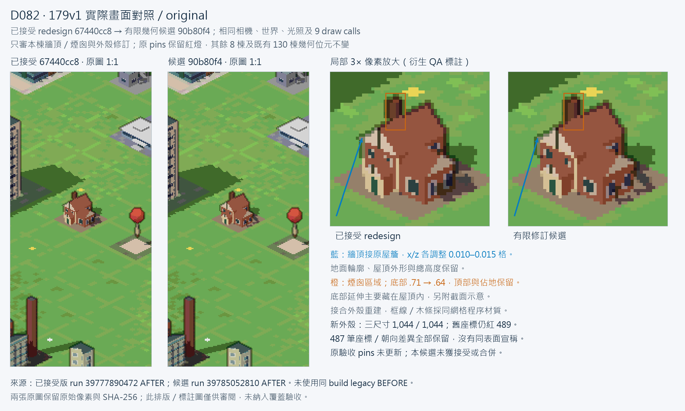
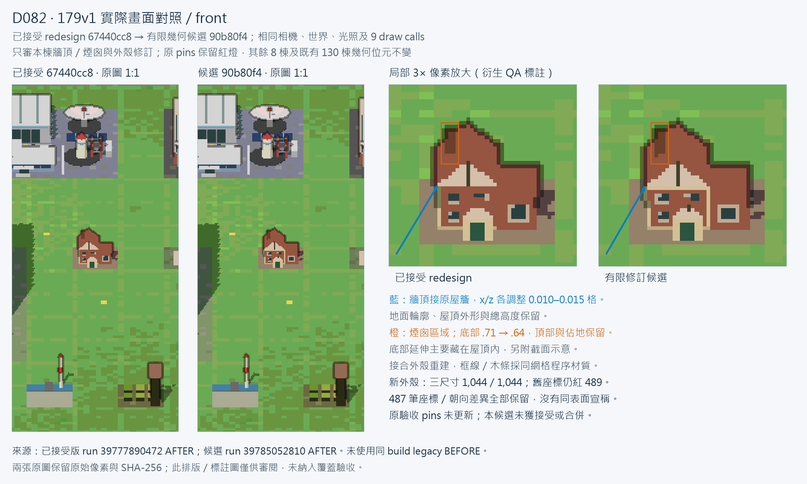

# D082 179v1 finite geometry proposal — unapproved

This is a separately reviewed physical repair proposal for one accepted prototype. The original D082 repair branch remains at `67440cc8de625f0482665c3f3f94efba73a1aed3`. No merge, Ready transition, deployment, replacement of accepted pins or claim of complete D082 acceptance is authorized here.

## Concrete change

The Arts-and-Crafts reading room retains its ground footprint, height, roof silhouette, palette, central timber strips, entrances and 48W/40O triangle inventory. Wall tops meet the original roof edges, making the building a joined outer shell. Top-wall x/z offsets are 0.010–0.015 parcel units; the ground corners are fixed. The chimney's internal foundation extends from normalized height .71 to .64 (world delta .0462 at H=.66), with the original top and footprint retained. The new shell clips internal intersections, then uses conforming subdivision to preserve the original triangle inventory.

The main hall's pale frame/base course and the two gable timber strips use explicit procedural facade masks in the same shadowed W mesh. No architecture is moved to D, no external asset is introduced and no draw call is added. Mask styles 6/7 are restricted to this model; existing atlas data and styles 0–5 are retained. Actual reference-family PNGs and a full scene/camera/world/geometry check accompany the preview.

## Independent physical evidence

Local typecheck/build pass. The emitted mesh costs 176 against the unchanged 182 ceiling, exactly 48W/40O triangles. All 36 affine cases pass finite/bounds/normal/budget and manifold/ground-footprint checks. The other eight target models and their 288 affine cases remain byte-identical to the immutable 67440cc baseline, as do all 130 prior models. Missing/reversed controls cover every candidate triangle, plus duplicate-face rejection: 177 controls.

The completed [proposal run 39785052810](https://github.com/lijiabao1998/GlimmerTown3D-lab/actions/runs/39785052810) checked actual product PNG manifests at widths 1440, 412 and 360. Each records 1,044 / 1,044 new exterior requirements covered, all 352 fixed triangle points required, 692 silhouette hits, seven real views and zero retained-internal exemptions. The unchanged D081 classifier and exact raw Three parity are used. Every one of the old 1,011 required IDs remains required, with 33 additional requirements. Original coordinate and byte-pin acceptance still fail; this new exterior result does not establish unchanged-surface equivalence.

## Exact approval boundary

Geometry bytes and probe coordinates change. The old accepted default hash `1ad82e98714bd84ae41435298b0cf6ada16e93ea56153ffb046eb3d183aca049` and all 36 old affine pins remain unchanged and reject this proposal. The emitted default candidate hash is `e33779d6bf749fe114fcc9e8079e6978d4acfcc956745df9d91735002f3cc2df`. The research mesh's raw serialization has a different diagnostic hash; the emitted product hash is authoritative for this proposal.

Retessellation and the wall/chimney correction move the surface associated with 487 old probe positions (198 fixed and 289 silhouette records). Their original records are preserved and explicitly re-audited; old frozen-coordinate coverage is not claimed to pass. ID preservation alone is not presented as equivalence of unchanged surfaces. The preview workflow retains the original structural/pin check as a mandatory failing result while producing physical proof and real images. No required flag is manually changed, no classifier/camera law/threshold is relaxed and no new accepted pin is installed.

Before this repair can be integrated, the finite geometry/coordinate delta and actual game appearance require review. The original approved artwork is not being resubmitted for approval; the request concerns this specific physical revision. The other eight D082 models still require their own repairs. Published D081/130 remains unchanged.

## Preview evidence

The isolated proposal workflow captures the original/context/front/rear/side product views, actual paired supplementary PNGs, complete production geometry, immutable world/history, legal owner fit, frame/full-render budgets and exact paused repeats. Compare the proposal's five AFTER views with the accepted 67440cc AFTER PNGs from [the completed production run](https://github.com/lijiabao1998/GlimmerTown3D-lab/actions/runs/39777890472) at identical cameras. The same-build legacy BEFORE images are historical D081 comparisons, not the accepted redesign.

The three-width proposal collector also re-audits every original required ID, all four points of each of the 88 new triangles, all new silhouette hits and the entire original frozen-coordinate contract. It records both the genuine new-surface result and the unresolved old-coordinate/pin difference. The original acceptance checker is unchanged.

### Reviewable actual comparisons

[Numerical wall/chimney section](evidence/D082-179v1-proposal/preview/geometry-section-179v1.png) explains the mostly hidden foundation extension. This section is explicitly a diagram, not a rendered acceptance image. The two comparison figures embed unchanged native-resolution PNGs and nearest-neighbour detail crops; annotations are derived QA figures and never enter coverage acceptance. Four unmodified PNGs and their hashes/cameras are retained in [the panel manifest](evidence/D082-179v1-proposal/preview/comparison-panels.json). Baselines are accepted redesign AFTER images from commit `67440cc8`, not the same-build legacy BEFORE.

The exact [487-record JSON ledger](evidence/D082-179v1-proposal/487-coordinate-delta.json) and [CSV ledger](evidence/D082-179v1-proposal/487-coordinate-delta.csv) preserve old/new positions, normals, displacement, orientation difference and required status. They contain 198 fixed and 289 silhouette records. All three actual candidate audits still miss 489 frozen old coordinates: these 487 changed records and two further chimney-ray failures (`mesh-1-triangle-15589-barycentric-1` and `-3`) explicitly recorded in the ledger. No claim is made that retaining an ID retains its original oriented surface.

The authoritative final product is 176 weighted units / 88 rendered triangles (48W, 40O, 0D), with 12 virtual ground triangles used only for closure. [Final emitted-product evidence](evidence/D082-179v1-proposal/final-authoritative-evidence.json) pins the actual tested source `90b80f4bc7e9a16d53fdc9127e9fe1e23f6c1694`, emitted default and 36-affine hashes, all three real capture results, 324 geometry cases and 177 negative controls. [The old research delta file](evidence/D082-179v1-proposal/geometry-deltas.json) retains its original uncommitted 216-weight / 120-with-ground-triangles fields, now explicitly labelled as early research superseded by the final evidence. No historical values were overwritten to present a false pass.

The proposal workflow is **failure overall**: the physical proof and all three actual image/new-exterior jobs pass, while the unchanged original accepted-pin gate remains mandatory and red. Only this finite 179v1 revision, including procedural frame/timber appearance and the explicit coordinate delta, awaits review. The other eight D082 models remain on their accepted baseline and are not claimed repaired.

### Original repair branch and inherited full-CI failures

The supplemental-capture repair is already pushed to the original branch at `67440cc8de625f0482665c3f3f94efba73a1aed3`. In [its completed run 39777890472](https://github.com/lijiabao1998/GlimmerTown3D-lab/actions/runs/39777890472), original structural checks and all three PNG/geometry jobs pass, but unchanged surface coverage remains red:

| Width | Missing before supplement | Actually recovered | Still mandatory and missing |
| --- | ---: | ---: | ---: |
| 1440 | 841 | 371 | 470 |
| 360 | 840 | 371 | 469 |
| 412 | 838 | 370 | 468 |

Residuals are 410 points inside independently declared solids, 14 exterior downward-bottom points, 42 eave/other exterior points and 4/3/2 junction-edge points respectively. These are diagnostic labels only; none is removed or made optional. All original 108 width-412 capture PNGs, cameras and canvas bytes match the previous accepted-source run exactly; supplements are actual additional paired PNGs.

The separate [full CI run 39777951186](https://github.com/lijiabao1998/GlimmerTown3D-lab/actions/runs/39777951186) has six completed failing jobs: `node-frame-d082` (old 59802 frame budget versus actual 60196, then surface coverage), `node-frame-d081` (historical selected-recipe dispatch isolation), three old `d082` width jobs (frozen scene qualification), and `node` (33 historical source-whitelist assertions plus two obsolete ten-model/checkpoint assertions). At this evidence snapshot, 57 jobs succeed and browser remains in progress. The original repair changed neither product sources, fixtures nor these old checker inputs relative to `24f56b7`; this establishes input preservation, not an unrun baseline full-CI result. None of these red historical gates was weakened. Terminal full-CI status is recorded separately when available.

Delivery updates after `90b80f4` contain only documentation and evidence. They do not constitute a fresh product CI pass. No workflow is rerun, no accepted pin is replaced, no PR is marked Ready, no merge occurs and no deployment is performed.
